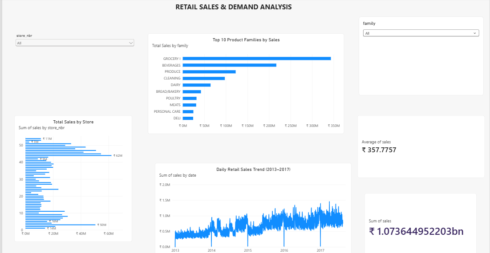

# Hi, I'm Abhishek 👋

### Aspiring Data Analyst | MCA Graduate

Welcome to my Data Analyst Portfolio! This repository showcases my practical work in data analysis, SQL, Python, data visualization, and machine learning.

## 🛠️ Technical Skills

- **Programming:** Python, SQL
- **Data Analysis:** Pandas, NumPy, Excel
- **Data Visualization:** Power BI, Matplotlib
- **Machine Learning:** Scikit-learn, Random Forest
- **Databases:** MySQL
- **Tools:** VS Code, Git, GitHub

## 📊 Projects

### 1. Retail Demand Forecasting & Inventory Optimization

- Analyzed retail sales data using Python and SQL.
- Performed exploratory data analysis and business analysis.
- Built demand forecasting models using Random Forest.
- Compared forecasting model performance.
- Developed an interactive Power BI dashboard.

**Technologies:** Python, SQL, Pandas, Scikit-learn, Power BI

### Dashboard Preview

[View Project](./01_Retail_Demand_Forecasting/)

### 2. Customer Churn Analytics
*Coming soon — customer behavior analysis and churn prediction.*

### 3. Sales Performance Analytics
*Coming soon — sales trends, business KPIs, and performance dashboards.*

## 🎓 Education

**Master of Computer Applications (MCA)**

## 🎯 Career Objective

Aspiring Data Analyst passionate about transforming raw data into meaningful insights and supporting data-driven business decisions.

## 📫 Connect With Me

- **GitHub:** [abhiiin10](https://github.com/abhiin10)
